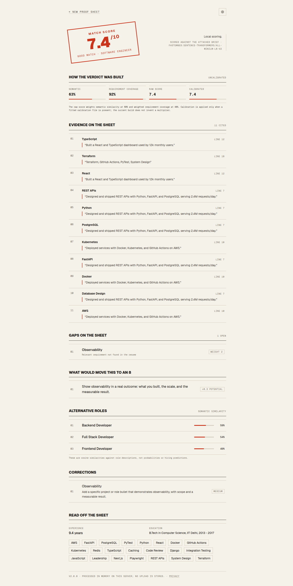
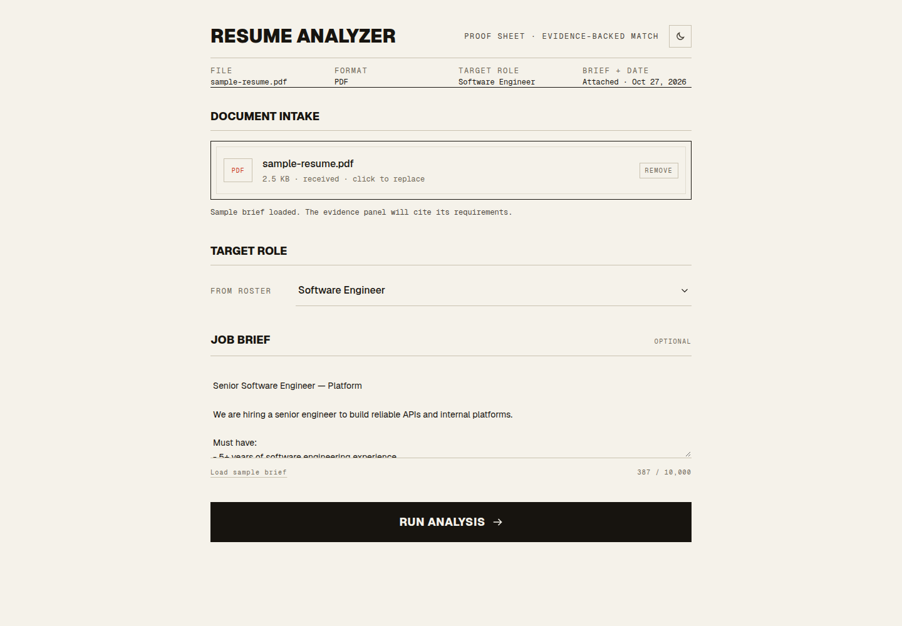
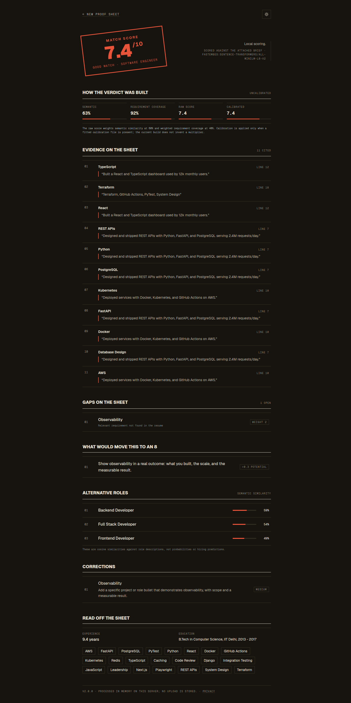

# Resume Analysis

An evidence-backed resume matcher. Upload a PDF or DOCX, choose a target role or paste a real job brief, and get a calibrated score with **cited resume lines**, **ranked gaps**, and **the specific changes that would move the score into the next band**.

Live demo: <https://resume-analysis-ruddy.vercel.app>



## Why this is not another resume-score wrapper

Most resume tools return a number and a list of keywords. This one returns a **proof sheet**:

- Every score is decomposed into semantic similarity and weighted requirement coverage.
- Every claimed match cites an exact resume line, verified against the extracted text.
- Missing requirements are ranked by weight and must-have status.
- The UI states whether scoring was local or AI-assisted, and which model produced it.
- The backend does not store uploads. AI review is opt-in and PII is redacted first.

The design direction is a print-shop proof sheet: bone stock, ink, one proof-red, hairline rules, numbered lanes. The aesthetic is deliberate, but the substance is the evidence trail.

## Features

| Area | What it does |
| --- | --- |
| Parsing | PDF (pypdf) and DOCX (python-docx), including DOCX tables, headers, and footers |
| Skill extraction | 155-skill canonical taxonomy with word-boundary alias matching |
| Experience | Date-range union with overlap handling, `Present` aware, explicit-years fallback |
| Education | Section-scoped degree and institution extraction |
| Role matching | 10 role templates with weighted, must-have-aware requirements |
| Job-description mode | Optional pasted JD becomes the requirement set, weighted by must/nice-to-have language |
| Evidence | Line-level citations with list-line suppression, plus semantic fallback for paraphrases |
| Gaps | Missing requirements ranked by weight and must-have status |
| Next band | Concrete actions with an expected-gain estimate |
| AI review | Optional OpenCode Go call with consent gate, redaction, JSON validation, and evidence verification |
| Failure modes | Explicit copy for 413 / 415 / 422 / 429 / 503, request IDs, no exception leakage |

## Screenshots

| Intake | Results, dark |
| --- | --- |
|  |  |

## Architecture

```
Browser (React + Vite, Vercel)
   │  multipart form: file, target_role, job_description, consent
   ▼
FastAPI (Oracle Cloud ARM, Docker, Caddy TLS)
   ├── parse_document()        PDF / DOCX → normalised lines
   ├── NLPAnalyzer             taxonomy skills, education, experience months, resume confidence
   ├── RoleMatcher             semantic chunks + weighted coverage → raw score → calibration
   │     └── fastembed/ONNX    all-MiniLM-L6-v2 (384d), shared across all requests
   └── LLMScorer (optional)    OpenCode Go → beam-free → glm-5.3-flash → local fallback
```

One embedder instance is loaded at startup and shared by the matcher. Model inference runs in a thread pool so it never blocks the event loop.

## Quickstart

### Backend

```bash
cd backend
python3 -m venv venv
source venv/bin/activate
pip install -r requirements.txt
cp .env.example .env
uvicorn app.main:app --reload --port 8000
```

The first start downloads the ONNX embedding model (~90 MB). Set `EMBEDDER_BACKEND=hash` for a dependency-free lexical fallback in CI or offline work.

### Frontend

```bash
cd frontend
npm install
cp .env.example .env
npm run dev
```

Open <http://localhost:5173>. Both a sample resume and a sample job brief ship in `frontend/public/samples/`, so the demo is testable without any personal data.

## How the score is built

```
raw = 10 × (0.6 × semantic + 0.4 × weighted_requirement_coverage)
```

- **Semantic** is the mean of the best chunk and the top-three mean against the role or JD description. The resume text is PII-redacted before embedding so names and contact details cannot move the score.
- **Coverage** is matched requirement weight divided by total requirement weight. Requirements may accept a family of equivalent skills (for example `REST APIs` accepts FastAPI, Django, Flask, Express, Spring, NestJS, or GraphQL).
- **Calibration** is identity by default. If `CALIBRATION_PATH` points at an isotonic fit produced by `eval/calibrate.py`, that curve is applied and its version is reported in the API response and the UI.

There is no hidden multiplier. The old `×1.12` fudge factor is gone; `eval/` exists so a real calibration curve replaces guesswork.

## Model and data card

| Item | Value |
| --- | --- |
| Embedding model | `sentence-transformers/all-MiniLM-L6-v2`, 384 dimensions |
| Serving runtime | fastembed + ONNX Runtime, CPU, single shared instance |
| Role templates | 10 roles, 8–10 weighted requirements each, curated in `backend/app/data/roles.yaml` |
| Skill taxonomy | 155 canonical skills with aliases and families in `backend/app/data/skills.yaml` |
| Training data | None. The local scorer is retrieval, not a trained classifier. |
| Fine-tuning | Optional cross-encoder script in `eval/finetune_reranker.py`; requires a labelled set larger than the seed data |
| Language | English |
| Known bias | The taxonomy and role templates reflect common English-language tech hiring language. The seed fairness probe is a probe, not an audit. |

### AI review

AI review is disabled by default and requires both `LLM_ENABLED=true` and an explicit consent checkbox.

| Property | Value |
| --- | --- |
| Provider | OpenCode Go, OpenAI-compatible endpoint |
| Primary model | `beam-free` |
| Fallback model | `glm-5.3-flash` |
| Paid fallback | Disabled (`OPENCODE_ALLOW_PAID_FALLBACK=false`) |
| Retained safety data | Beam Free: 30 days, no training. GLM fallback: 0-day retention |
| Never used | `iceman-contributor-free` (trains on prompts and completions) |
| Redaction | Email, phone, URL, profile handles, street addresses, conservative name heuristic |
| Guardrails | 50 requests/day default, 80% allowance guard, 30 s timeout, one retry |
| Verification | Any LLM evidence quote that does not appear verbatim in the resume is discarded |

Redaction reduces risk; it is not a guarantee. See `/privacy.html` for the user-facing notice.

## Evaluation

`eval/` contains a working harness with a **hand-labelled 18-pair seed set**. It exists to prove the pipeline and metrics run end to end. It is not the final benchmark and must not be cited as one.

```bash
cd eval
../backend/venv/bin/python build_seed.py
../backend/venv/bin/python run_eval.py --baseline tfidf --baseline hash --baseline minilm --baseline matcher
../backend/venv/bin/python fairness.py --baseline matcher
../backend/venv/bin/python benchmark.py
```

Seed-set results (x86 development machine, not production ARM):

| Baseline | NDCG@10 | MRR@10 | Recall@10 | Spearman | ECE |
| --- | --- | --- | --- | --- | --- |
| TF-IDF | 0.993 | 1.000 | 1.000 | 0.899 | 0.312 |
| Hash embedder | 0.892 | 0.833 | 1.000 | 0.655 | 0.303 |
| MiniLM only | 0.978 | 1.000 | 1.000 | 0.622 | 0.281 |
| Production matcher | 0.996 | 1.000 | 1.000 | 0.841 | 0.081 |

The ranking metrics are near ceiling because 18 pairs across 3 job descriptions is an easy set. The useful signals are the **ECE drop from ~0.28 to 0.08** and the ranking gap between the hash fallback and the semantic path. Both need confirmation on the full set.

Latency on the same machine (single request, warm model):

| Baseline | p50 | p95 |
| --- | --- | --- |
| TF-IDF | 0.7 ms | 1.0 ms |
| MiniLM | 31.2 ms | 43.4 ms |
| Production matcher | 60.3 ms | 86.6 ms |

Fairness probe: swapping synthetic names or university prestige changes the production matcher score by **0.0**, because the scoring path is PII-redacted. The MiniLM-only baseline moves by up to 0.044, which is why redaction happens before embedding.

### What is still required for a real v2 claim

1. 300–500 independently labelled resume/JD pairs (1,000 stretch), double-labelled with adjudication.
2. A held-out test split fixed before model selection.
3. NDCG@10, MRR@10, Recall@10, Spearman, MAE, ECE, and subgroup deltas with bootstrap confidence intervals.
4. A fine-tuned cross-encoder baseline compared against MiniLM and the production matcher.
5. ONNX export and an ARM latency benchmark on the actual Oracle VM.
6. A calibration curve fit on validation data only, then frozen and versioned.

Until then the honest claim is: **the pipeline is production-shaped and measured on a smoke-test set**, not "state of the art".

## Deployment

### Backend: Oracle Cloud Always Free (ARM Ampere A1)

Target: 4 OCPU / 24 GB Ampere A1, Ubuntu 24.04, Docker Compose, Caddy for automatic TLS.

```bash
# On the VM
sudo mkdir -p /opt/resumeanalysis
sudo chown "$USER":"$USER" /opt/resumeanalysis
git clone https://github.com/krtk06/ResumeAnalysis.git /opt/resumeanalysis
cd /opt/resumeanalysis

cp deploy/oracle/.env.example deploy/oracle/.env
chmod 600 deploy/oracle/.env
$EDITOR deploy/oracle/.env      # API_DOMAIN, CORS_ORIGINS, OPENCODE_API_KEY
./deploy/oracle/deploy.sh
```

Open ingress for TCP 80 and 443 in the OCI security list and in `ufw`. Caddy obtains and renews the certificate automatically. With a reserved public IP, `sslip.io` gives a working hostname without owning a domain:

```dotenv
API_DOMAIN=api.203.0.113.10.sslip.io
```

Verify:

```bash
curl -fsS https://api.203.0.113.10.sslip.io/api/health/ready
```

A GitHub Actions workflow (`.github/workflows/deploy.yml`) can redeploy over SSH on pushes to `main` when `ORACLE_HOST`, `ORACLE_USER`, and `ORACLE_SSH_KEY` are set as repository secrets.

### Frontend: Vercel

`VITE_API_URL` is baked in at build time.

```bash
cd frontend
vercel env add VITE_API_URL production   # https://api.<host>
vercel --prod
```

A production build fails loudly if `VITE_API_URL` is missing, still contains a placeholder, or is not HTTPS. That replaces the previous silent failure where the deployed bundle called a literal placeholder URL. Preview builds are allowed to fall back to localhost so pull requests still deploy a UI preview.

## API

| Method | Endpoint | Description |
| --- | --- | --- |
| `POST` | `/api/analyze` | `file`, `target_role`, optional `job_description`, optional `consent` |
| `GET` | `/api/health` | Liveness |
| `GET` | `/api/health/ready` | Readiness; verifies the embedder and matcher are loaded |
| `GET` | `/api/roles` | Role names from the server-side templates |
| `GET` | `/api/config` | Feature flags, limits, sample and privacy URLs |
| `GET` | `/docs` | OpenAPI UI |

Example:

```bash
curl -fsS https://api.example.com/api/analyze \
  -F "file=@frontend/public/samples/sample-resume.pdf" \
  -F "target_role=Software Engineer" \
  -F "job_description=$(cat frontend/public/samples/sample-jd.txt)" \
  -F "consent=false"
```

Response highlights:

```json
{
  "score": 7.4,
  "band": "Good match",
  "matched_role": "Software Engineer",
  "rubric": {
    "semantic": 0.626,
    "coverage": 0.917,
    "raw_score": 7.4,
    "calibrated_score": 7.4,
    "calibration_version": "identity"
  },
  "evidence": [
    {
      "requirement": "REST APIs",
      "quote": "Designed and shipped REST APIs with Python, FastAPI, and PostgreSQL serving 2.4M requests/day.",
      "line": 7,
      "strength": 1.0,
      "source": "resume"
    }
  ],
  "missing_requirements": [
    { "requirement": "Observability", "weight": 2, "must_have": false }
  ],
  "scoring_source": "local_llm_disabled",
  "privacy": {
    "llm_enabled": true,
    "consent_given": false,
    "external_llm_used": false
  }
}
```

## Security and privacy

- Uploads are read in fixed-size chunks and capped at 10 MB before parsing.
- PDF page count is capped. DOCX archives are checked for entry count, expanded size, and compression ratio before parsing.
- Legacy `.doc` is rejected explicitly rather than failing obscurely.
- Uploaded bytes and extracted text are never written to disk or logged. Logs contain request ID, source, score, role, format, byte count, and skill count only.
- Errors return a safe message plus a request ID. Exception text never reaches the client.
- Per-IP sliding-window rate limiting (10/hour, 50/day by default) and a daily LLM budget guard.
- CORS is an explicit origin allowlist. `TRUST_PROXY_HEADERS` is only enabled behind Caddy.
- Security headers on both layers: `nosniff`, `Referrer-Policy`, `Permissions-Policy`, `X-Frame-Options` on Vercel.
- Prompt injection is mitigated by XML-delimited untrusted input, a system prompt that forbids instruction following, and verbatim verification of every returned evidence quote.
- Dependencies are pinned in `uv.lock`, exported to hashed `requirements.txt`, scanned by `pip-audit` in CI, and updated by Dependabot.

This is a portfolio demo, not a hiring system. Real candidate processing would additionally need a lawful basis, a retention and deletion policy, and a cross-border transfer review.

## Tests, linting, and CI

```bash
cd backend
pytest -q
ruff check app tests
ruff format --check app tests
mypy app
```

CI runs the backend suite, lint, type checks, a dependency audit, the frontend build, and a container smoke test against `/api/health/ready`.

## Project structure

```
ResumeAnalysis/
├── backend/
│   ├── app/
│   │   ├── config.py              # pydantic-settings, single source of truth
│   │   ├── main.py                # app factory, lifespan, logging, errors
│   │   ├── ml.py                  # fastembed / ST / hash embedders
│   │   ├── data/                  # skills.yaml, roles.yaml
│   │   ├── models/schemas.py      # response contract
│   │   ├── routes/analyze.py      # API endpoints
│   │   └── services/
│   │       ├── resume_parser.py   # PDF/DOCX extraction and validation
│   │       ├── taxonomy.py        # matching, roles, JD requirements
│   │       ├── nlp_analyzer.py    # entities, experience, confidence
│   │       ├── matcher.py         # scoring, evidence, gaps, calibration
│   │       ├── llm_scorer.py      # OpenCode Go client and verification
│   │       ├── redaction.py       # PII redaction
│   │       └── rate_limit.py      # IP limiter and LLM budget
│   ├── tests/                     # parser, NLP, matcher, API, security
│   ├── pyproject.toml
│   ├── uv.lock
│   ├── requirements.txt
│   └── Dockerfile
├── frontend/
│   ├── public/                    # favicon, OG image, privacy, sample resume
│   ├── scripts/validate-env.mjs
│   └── src/
├── deploy/oracle/                 # compose, Caddyfile, deploy script
├── eval/                          # metrics, baselines, calibration, benchmark
└── .github/workflows/             # CI and deploy
```

## Roadmap

- [x] Replace OpenAI with OpenCode Go, with local fallback and budget guard
- [x] Optional job-description mode
- [x] Evidence citations and ranked gaps
- [x] Deterministic taxonomy with word-boundary matching
- [x] Shared ONNX embedder, app factory, readiness probe
- [x] Docker, CI, pinned dependencies, Oracle deploy scripts
- [x] Seed evaluation harness with ranking, calibration, fairness, and latency
- [ ] Label 300–500 pairs and freeze a held-out split
- [ ] Fine-tuned cross-encoder baseline
- [ ] Fit and version a production calibration curve
- [ ] ARM benchmark and cold-start budget on the Oracle VM
- [ ] Persist nothing but aggregate metrics; add an opt-in feedback loop

## License

MIT © 2026 krtk. See [LICENSE](LICENSE).
